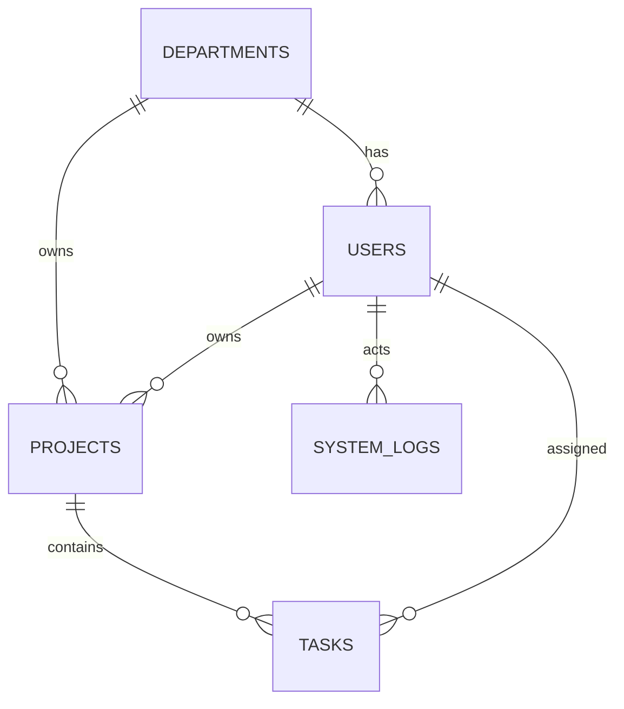

# Database Design Documentation

## Schema Overview

## Tables

### departments
| Column | Type | Constraints | Description |
|--------|------|-------------|-------------|
| id | uuid | PK, default gen_random_uuid() | Unique identifier |
| name | varchar(100) | NOT NULL, UNIQUE | Department name |
| is_active | boolean | NOT NULL, default true | Soft deletion flag |
| created_at | timestamptz | NOT NULL | Creation timestamp |
| updated_at | timestamptz | NOT NULL | Last update timestamp |
| version | integer | NOT NULL, default 1 | Optimistic lock |

**Indexes:**
- `ix_departments_name` (UNIQUE) on `name`
- `ix_departments_is_active` on `is_active`

### users
| Column | Type | Constraints | Description |
|--------|------|-------------|-------------|
| id | uuid | PK, default gen_random_uuid() | Unique identifier |
| department_id | uuid | NOT NULL, FK → departments.id | Department assignment |
| email | varchar(256) | NOT NULL | User email |
| normalized_email | varchar(256) | NOT NULL, UNIQUE | Uppercase email for lookup |
| display_name | varchar(100) | NOT NULL | Display name |
| password_hash | varchar(512) | NOT NULL | BCrypt hash |
| role | integer | NOT NULL, default 4 | UserRole enum (1=Admin, 2=Manager, 3=Contributor, 4=Viewer) |
| is_active | boolean | NOT NULL, default true | Soft deletion flag |
| created_at | timestamptz | NOT NULL | Creation timestamp |
| updated_at | timestamptz | NOT NULL | Last update timestamp |
| deactivated_at | timestamptz | NULL | Deactivation timestamp |
| version | integer | NOT NULL, default 1 | Optimistic lock |

**Indexes:**
- `ix_users_normalized_email` (UNIQUE) on `normalized_email`
- `ix_users_department_id` on `department_id`
- `ix_users_is_active` on `is_active`

**Foreign Keys:**
- `fk_users_department` → departments(id) ON DELETE RESTRICT

### projects
| Column | Type | Constraints | Description |
|--------|------|-------------|-------------|
| id | uuid | PK, default gen_random_uuid() | Unique identifier |
| department_id | uuid | NOT NULL, FK → departments.id | Owning department |
| owner_user_id | uuid | NOT NULL, FK → users.id | Project owner |
| name | varchar(200) | NOT NULL | Project name |
| description | varchar(2000) | NULL | Project description |
| status | integer | NOT NULL, default 1 | ProjectStatus enum (1=Planned, 2=Active, 3=OnHold, 4=Completed, 5=Cancelled) |
| start_at | timestamptz | NULL | Project start date |
| due_at | timestamptz | NULL | Project due date |
| created_at | timestamptz | NOT NULL | Creation timestamp |
| updated_at | timestamptz | NOT NULL | Last update timestamp |
| deleted_at | timestamptz | NULL | Soft deletion timestamp |
| version | integer | NOT NULL, default 1 | Optimistic lock |

**Indexes:**
- `ix_projects_department_status` on (department_id, status) WHERE deleted_at IS NULL
- `ix_projects_owner_user_id` on owner_user_id
- `ix_projects_deleted_at` on deleted_at

**Foreign Keys:**
- `fk_projects_department` → departments(id) ON DELETE RESTRICT
- `fk_projects_owner` → users(id) ON DELETE RESTRICT

### tasks
| Column | Type | Constraints | Description |
|--------|------|-------------|-------------|
| id | uuid | PK, default gen_random_uuid() | Unique identifier |
| project_id | uuid | NOT NULL, FK → projects.id | Parent project |
| assigned_to_user_id | uuid | NULL, FK → users.id | Assignee |
| title | varchar(200) | NOT NULL | Task title |
| description | varchar(2000) | NULL | Task description |
| status | integer | NOT NULL, default 1 | TaskStatus enum (1=Todo, 2=InProgress, 3=Blocked, 4=Done, 5=Cancelled) |
| priority | integer | NOT NULL, default 2 | TaskPriority enum (1=Low, 2=Medium, 3=High, 4=Critical) |
| due_at | timestamptz | NULL | Task due date |
| completed_at | timestamptz | NULL | Completion timestamp |
| created_at | timestamptz | NOT NULL | Creation timestamp |
| updated_at | timestamptz | NOT NULL | Last update timestamp |
| deleted_at | timestamptz | NULL | Soft deletion timestamp |
| version | integer | NOT NULL, default 1 | Optimistic lock |

**Indexes:**
- `ix_tasks_project_status` on (project_id, status) WHERE deleted_at IS NULL
- `ix_tasks_assigned_user` on assigned_to_user_id WHERE deleted_at IS NULL AND assigned_to_user_id IS NOT NULL
- `ix_tasks_due_at` on due_at WHERE deleted_at IS NULL AND status NOT IN (4,5) AND due_at IS NOT NULL
- `ix_tasks_deleted_at` on deleted_at

**Foreign Keys:**
- `fk_tasks_project` → projects(id) ON DELETE CASCADE
- `fk_tasks_assignee` → users(id) ON DELETE SET NULL

### system_logs
| Column | Type | Constraints | Description |
|--------|------|-------------|-------------|
| id | uuid | PK, default gen_random_uuid() | Unique identifier |
| actor_user_id | uuid | NULL, FK → users.id | Actor (nullable for system events) |
| action | integer | NOT NULL | AuditAction enum |
| entity_type | varchar(100) | NOT NULL | Entity type name |
| entity_id | uuid | NOT NULL | Affected entity ID |
| outcome | integer | NOT NULL | AuditOutcome enum (1=Success, 2=Failure) |
| trace_id | varchar(100) | NOT NULL | Request trace ID |
| metadata | jsonb | NULL | Additional context |
| created_at | timestamptz | NOT NULL | Event timestamp |

**Indexes:**
- `ix_system_logs_created_at_desc` on created_at DESC
- `ix_system_logs_entity_type_entity_id_created_at` on (entity_type, entity_id, created_at DESC)
- `ix_system_logs_actor_user_id` on actor_user_id

**Foreign Keys:**
- `fk_system_logs_actor` → users(id) ON DELETE SET NULL

### ASP.NET Core Identity Tables
- `aspnet_users` - Identity users (linked to business users via ID)
- `aspnet_roles` - Identity roles
- `aspnet_user_roles` - User-role mapping
- `aspnet_user_claims`, `aspnet_user_logins`, `aspnet_user_tokens`, `aspnet_role_claims` - Standard Identity tables

## Design Decisions

### UUIDs for All Business Entities
- Globally unique, no coordination needed
- Works well with distributed systems
- EF Core default: `gen_random_uuid()`

### timestamptz for All Timestamps
- Timezone-aware storage
- Returned as ISO 8601 UTC (e.g., `2024-01-15T10:30:00Z`)
- Application layer uses `DateTimeOffset`

### Soft Deletion Pattern
- Projects and Tasks: `deleted_at` timestamp
- Users and Departments: `is_active` boolean + `deactivated_at`
- Queries filter by default: `WHERE deleted_at IS NULL` / `WHERE is_active = TRUE`
- Preserves referential integrity for audit/history

### Optimistic Concurrency
- `version` column on all business entities
- Incremented on every update
- `IsConcurrencyToken()` in EF Core
- Clients use `If-Match` header

### Enum Storage as Integers
- Small, fast, indexed efficiently
- Application layer maps to C# enums
- Database constraints via CHECK or application validation

### jsonb for Audit Metadata
- Flexible structured data
- Queryable in PostgreSQL
- Size-limited by application validation

## Migration Strategy

1. All migrations in version control
2. Migration bundle for deployment
3. One-shot migration container in Compose
4. Runtime user has minimal permissions (no DDL)
5. Test both fresh install and upgrade paths

## Performance Considerations

- Partial indexes for common filtered queries
- Composite indexes for multi-column lookups
- Covering indexes where query patterns warrant
- Regular `ANALYZE` and `VACUUM` via PostgreSQL autovacuum